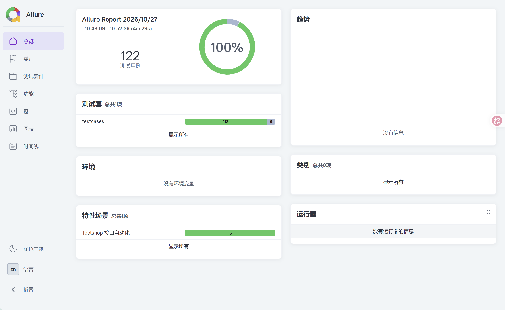
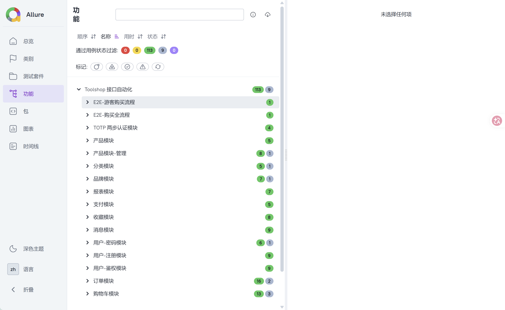
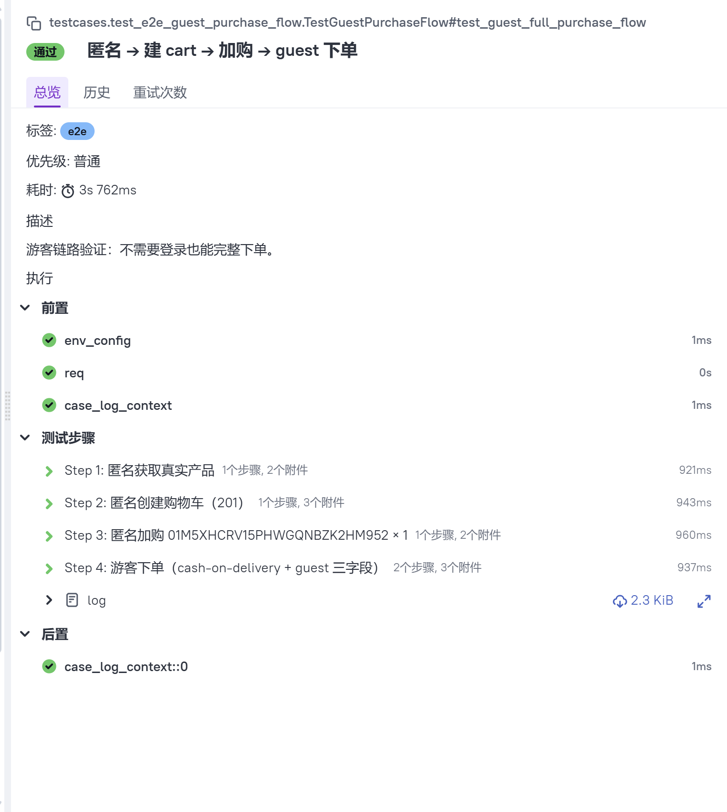

# README.md

## config 配置层

上层从该层获取base_url

## utils 封装层

请求封装

## api 接口封装层

把每个接口封装成一个方法，让用例读起来像业务描述。

## data 数据层

yaml文件实现测试数据与代码分离

## testcases 测试用例层

@pytest.mark.parametrize 把 YAML 数据变成多条独立用例

## allure-results 报告层

pytest --alluredir=./allure-results
allure serve ./allure-results

# Toolshop API Automation

# Toolshop API Automation

基于 [Practice Software Testing](https://practicesoftwaretesting.com) 的接口自动化测试框架。
覆盖 11 个业务模块、115+ 条测试用例、2 条 E2E 业务流，发现 5 个真实 BUG（含 2 个 OWASP API Security 越权问题）。

[](https://github.com/<your-username>/toolshop-api-auto/actions/workflows/test.yml)

## 目录

- [技术栈](#技术栈)
- [项目结构](#项目结构)
- [快速开始](#快速开始)
- [测试覆盖](#测试覆盖)
- [已发现 BUG](#已发现-bug5-个)
- [契约偏差](#契约偏差文档-vs-实现)
- [关键设计](#关键设计)
- [项目亮点](#项目亮点面试可讲)
- [扩展指南](#扩展指南)

## 技术栈

| 组件 | 版本 | 用途 |
|---|---|---|
| Python | 3.8+ | 主语言 |
| pytest | 8.3.5 | 测试框架 |
| requests | 2.32.3 | HTTP 客户端 |
| allure-pytest | 2.13.5 | 测试报告 |
| PyYAML | 6.0.2 | 数据驱动 |
| python-dotenv | 1.0.1 | 环境变量管理 |

## 项目结构

```
toolshop-api-auto/
├── .env                      # 测试账号（不入库）
├── .env.example              # .env 模板
├── .gitignore
├── pytest.ini                # pytest 配置
├── requirements.txt
├── README.md
├── api/                      # 接口封装层（一个文件对应一个资源）
│   ├── user_api.py           # 用户：login/logout/refresh/me/register/forgot/change
│   ├── product_api.py        # 商品：list/detail/related + admin CRUD
│   ├── cart_api.py           # 购物车：create/add/get/update/delete
│   ├── invoice_api.py        # 订单：create/get/list/status/guest/pdf
│   ├── favorite_api.py       # 收藏
│   ├── message_api.py        # 消息
│   ├── payment_api.py        # 支付校验
│   ├── totp_api.py           # TOTP 两步认证
│   ├── brand_api.py          # 品牌
│   ├── category_api.py       # 分类
│   └── report_api.py         # 报表
├── data/                     # 测试数据层（YAML 驱动，一个文件对应一个资源）
│   ├── user_data.yaml
│   ├── product_data.yaml
│   ├── cart_data.yaml
│   ├── invoice_data.yaml
│   ├── favorite_data.yaml
│   ├── message_data.yaml
│   ├── payment_data.yaml
│   ├── totp_data.yaml
│   ├── brand_data.yaml
│   ├── category_data.yaml
│   └── report_data.yaml
├── testcases/                # 测试用例层
│   ├── conftest.py           # fixture + 生命周期钩子
│   ├── test_user.py          # 登录/注册/密码 23 条
│   ├── test_product.py       # 商品 18 条
│   ├── test_cart.py          # 购物车 16 条
│   ├── test_invoice.py       # 订单 18 条
│   ├── test_favorite.py      # 收藏 8 条
│   ├── test_message.py       # 消息 9 条
│   ├── test_payment.py       # 支付 5 条
│   ├── test_totp.py          # TOTP 4 条
│   ├── test_brand.py         # 品牌 6 条
│   ├── test_category.py      # 分类 6 条
│   ├── test_report.py        # 报表 5 条
│   ├── test_e2e_purchase_flow.py        # E2E 登录用户购买
│   └── test_e2e_guest_purchase_flow.py  # E2E 游客购买
├── utils/
│   ├── request_util.py       # 请求封装（日志 + Allure attach + token 自动续期）
│   ├── assert_util.py        # 断言工具
│   ├── yaml_util.py          # YAML 读写 + extract 持久化
│   ├── log_util.py           # 日志
│   └── totp_util.py          # TOTP 算法（RFC 6238）
├── config/
│   └── env.yaml              # 环境配置
├── docs/
│   └── screenshots/          # Allure 报告截图
└── logs/
    └── test.log
```

## 快速开始

### 1. 环境准备

```bash
git clone <repo-url>
cd toolshop-api-auto
pip install -r requirements.txt
```

### 2. 配置账号

复制 `.env.example` 为 `.env`，填入测试账号：

```bash
# 管理员账号（官方文档提供）
ADMIN_EMAIL=admin@practicesoftwaretesting.com
ADMIN_PASSWORD=welcome01

# 普通用户账号（官方文档提供，或用你自己的注册账号）
USER_EMAIL=customer2@practicesoftwaretesting.com
USER_PASSWORD=welcome01
```

> **注意**：`.env` 在 `.gitignore` 中，不会提交到仓库。

### 3. 运行测试

```bash
# 全量运行
pytest

# 只跑单接口（跳过 E2E）
pytest -m "not e2e"

# 跳过慢测试（forgot-password / change-password）
pytest -m "not slow"

# 只跑 E2E
pytest -m e2e

# 并行运行（需安装 pytest-xdist）
pytest -n 4
```

### 4. 查看 Allure 报告

```bash
# 自动打开浏览器
allure serve allure-results

# 或生成静态报告
allure generate allure-results -o allure-report --clean
allure open allure-report
```

### 5. 报告截图




单条用例展示（含请求/响应 attach + step 分组）：


## 测试覆盖

**115 条测试用例，11 个模块，2 条 E2E：**

| 模块 | 用例数 | 覆盖内容 |
|---|---|---|
| 用户-鉴权 | 9 | login / logout / refresh / me |
| 用户-注册 | 9 | 正常 / 缺字段 / 弱密码 / 未成年 / 重复邮箱 |
| 用户-密码 | 5 | forgot-password / change-password |
| 商品 | 18 | 列表 / 详情 / related / admin CRUD |
| 购物车 | 16 | 创建 / 加购 / 查 / 改数量 / 删商品 / 删车 |
| 订单 | 18 | 创建 / 查 / 列表 / 状态 / 游客 / PDF |
| 收藏 | 8 | 增 / 删 / 查 / 重复 |
| 消息 | 9 | 发送 / 列表 / 回复 / 附件 |
| 支付 | 5 | 校验 + 公开性 |
| TOTP | 4 | setup / verify / 错误码 |
| 品牌 / 分类 | 12 | admin CRUD + 权限 |
| 报表 | 5 | 4 个报表 + 权限 |
| **E2E** | **2** | 登录购买 / 游客购买 |

**当前测试结果**：`113 passed, 1 skipped, 8 xfailed`

- `8 xfailed`：5 个真实 BUG 对应的预期失败用例（见下节）
- `1 skipped`：PDF 生成是异步的，30 秒内未生成则跳过

## 已发现 BUG（5 个）

| 编号 | 位置 | 类型 | 严重度 | 验证用例 |
|---|---|---|---|---|
| BUG-001 | `POST /carts/{id}` 非法 quantity | 参数校验错误码（404 而非 422） | 低 | `test_cart.py::test_add_to_cart[加购-数量0/负数数量]` |
| BUG-002 | `DELETE /carts/{cartId}` 未登录 | **越权（OWASP API1:2023 BOLA）** | **高** | `test_cart.py::test_delete_cart[删除购物车-未登录]` |
| BUG-003 | `POST /invoices/guest` 缺 guest_email | 请求体校验错误码（404 而非 422） | 中 | `test_invoice.py::test_guest_invoice[游客下单-缺 guest_email]` |
| BUG-004 | `POST /users/change-password` 两次密码不一致 | 请求体校验错误码（404 而非 422） | 中 | `test_user.py::test_change_password[改密码-两次新密码不一致]` |
| BUG-005 | `POST /products` / `POST /brands` / `POST /categories` | **普通用户可创建（RBAC 中间件漏配，OWASP API5:2023 BFLA）** | **高** | `test_product.py::test_create_product_forbidden` 等 |

### BUG 详解

#### BUG-001：购物车非法 quantity 返回 404

- **位置**：`POST /carts/{id}`
- **复现**：`quantity=0` 或 `quantity=-1`
- **实际**：404 `{"message":"Requested item not found"}`
- **预期**：422（请求体参数非法）
- **影响**：客户端无法区分"商品不存在"和"quantity 非法"
- **归属**：契约偏差，严重度低

#### BUG-002：购物车越权删除（OWASP API1）

- **位置**：`DELETE /carts/{cartId}`
- **复现**：
  1. 用户 A 登录，创建购物车，记下 `cart_id`
  2. 用户 B 登录，用 B 的 token 调 `DELETE /carts/{A的cart_id}`
- **实际**：返回 204，A 的购物车被删
- **预期**：401 / 403
- **影响**：攻击者只需知道 `cart_id` 即可删除任意用户购物车
- **归属**：OWASP API Security Top 10 中的 API1:2023 Broken Object Level Authorization
- **证据**：Swagger 声明该接口 401 需鉴权，实际匿名可调

#### BUG-003：游客下单缺 guest_email 返回 404

- **位置**：`POST /invoices/guest`
- **复现**：请求体不带 `guest_email` 字段
- **实际**：404 `{"message":"Resource not found"}`
- **预期**：422（缺必填字段）
- **影响**：客户端误判为"端点不存在"，浪费排障时间
- **归属**：契约偏差，严重度中

#### BUG-004：改密码两次不一致返回 404

- **位置**：`POST /users/change-password`
- **复现**：`new_password` 与 `new_password_confirmation` 不一致
- **实际**：404 `{"message":"Resource not found"}`
- **预期**：422 或 400
- **额外证据**：同接口"旧密码错误"返回 400，"两次密码不一致"返回 404，错误码内部不一致
- **归属**：错误码内部一致性问题，严重度中

#### BUG-005：RBAC 中间件漏配（OWASP API5）

- **位置**：`POST /products`、`POST /brands`、`POST /categories`
- **复现**：普通用户 token（`customer2@...`）调用上述接口，payload 合法
- **实际**：返回 201，成功创建
- **预期**：403 Forbidden（admin only）
- **影响**：普通用户可篡改核心业务数据（商品/品牌/分类），可构造恶意 product 上架
- **归属**：OWASP API Security Top 10 中的 API5:2023 Broken Function Level Authorization

**额外证据（关键）**：

| 接口 | 普通用户调用 | 结果 |
|---|---|---|
| `POST /products` | 201 成功 | ❌ 越权 |
| `POST /brands` | 201 成功 | ❌ 越权 |
| `POST /categories` | 201 成功 | ❌ 越权 |
| `DELETE /products` | 403 拦截 | ✅ 正确 |
| `GET /reports/*` | 403 拦截 | ✅ 正确 |

**结论**：后端采用**逐路由手动挂 admin 中间件**，product/brand/category 的**创建路由**漏配，但删除和报表路由配置正确。**是一个"局部漏配"而非"整体缺失"的问题**。

## 契约偏差（文档 vs 实现）

| # | 位置 | 文档 | 实际 |
|---|---|---|---|
| 1 | `POST /invoices` 成功码 | 200 | **201** |
| 2 | `POST /favorites` 成功码 | 200 | **201** |
| 3 | `POST /messages` 响应体 | `{"success": true}` | 完整 message 对象 |
| 4 | `POST /messages/{id}/reply` 成功码 | 200 | **201** |
| 5 | `PUT /carts/{id}/product/quantity` 响应 | `{"success": true}` | `{"result": "..."}` |
| 6 | `PUT /carts/{id}/product/quantity` 语义 | 未文档化 UPSERT | UPSERT（商品不存在时等价加购） |
| 7 | `POST /payment/check` 字段校验 | 文档未列 422 | 不校验字段（mock 响应） |
| 8 | `POST /payment/check` 响应文案 | `Success status` | `Payment was successful` |
| 9 | `POST /products` 成功码 | 200 | **201** |
| 10 | `POST /products` co2_rating | 隐含枚举 | 无枚举约束（任意字符串接受） |
| 11 | `POST /users/change-password` 密码校验失败 | 422 | **400** |

**说明**：契约偏差不一定是 BUG——有些是文档滞后于实现（如成功码 200→201 是 REST 语义更正确的选择），有些是设计选择（如 payment/check 不校验字段）。**记录这些偏差的目的是：让测试的断言与真实契约一致，避免假失败。**

## 关键设计

### 1. 数据分层：bootstrap + 回捞

**问题**：invoice 的 billing 有 country-city 联动白名单校验，把合法地址硬编码在每条用例会扩散维护成本。

**方案**：
- `bootstrap_billing`：唯一硬编码（抓包验证过的 `DM + New Joaquinberg`），只用于创建第一张真实 invoice
- `real_billing_address`：从 `POST /invoices` 响应体回捞 billing 字段，供所有正常用例复用
- 错误用例（"缺街道"）显式覆盖 billing

**收益**：地址库变更时只改 `bootstrap_billing` 一处，不扩散。

### 2. 账号隔离：防止污染

**问题**：用户故事 AC4 规定 3 次密码错误锁定账号。错误登录用例若直接用 USER 账号，累积会锁定，导致整个测试套件级联 ERROR。

**方案**：

| Fixture | 作用域 | 用途 |
|---|---|---|
| `token` / `auth_req` | session | 正常业务（cart/invoice/favorite/message）|
| `admin_token` / `admin_req` | session | admin 功能（含 JWT role 断言）|
| `throwaway_user` | function | **所有会污染账号状态的测试**（密码错误、改密码、TOTP、E2E）|
| `ephemeral_auth_req` | function | logout / refresh 这类会让 token 失效的测试 |

**收益**：USER 账号永不被误锁，套件可反复运行。

### 3. BUG 标记：xfail(strict=True)

YAML 里 `xfail: true` 的用例转成 `pytest.mark.xfail(strict=True)`：
- BUG 存在 → **XFAIL**（符合预期，不报错）
- BUG 被修复 → **XPASS(strict)** 作为失败，**强制提醒回来删掉 xfail 标记**

避免"BUG 修复了但测试还标 xfail"的假绿。

### 4. Token 自动续期

**问题**：后端 JWT 有效期 5 分钟，完整跑完套件需要 4-5 分钟，时间边界处 token 失效导致后续用例 401。

**方案**：
- `RequestUtil` 检测到 401 时自动调用 `relogin` 回调重新登录、更新 Authorization header、重试原请求（仅 1 次）
- 排除 login 端点本身（防止无限递归）
- 搭配 `urllib3.Retry` 处理网络瞬时抖动

### 5. 契约确认：先证据后断言

遇到不确定的字段格式（如 billing country 是否 ISO 码、成功码是否 200/201），**先抓包或 Swagger UI 实测，不靠猜**。本文档的"契约偏差"清单就是这套流程的产物。

## 项目亮点（面试可讲）

1. **数据分层**：bootstrap-回捞模式解决 billing 地址硬编码问题，变更影响面收敛到 1 处
2. **账号隔离**：`throwaway_user` fixture 避免污染共享账号，解决"错误登录测试必然锁定账号"的结构性矛盾
3. **BUG 发现**：5 个真实 BUG，其中 2 个属 OWASP API Security Top 10 范畴（BOLA + BFLA）
4. **契约治理**：发现 11 处文档与实现不一致，均为**先证据后断言**的产物
5. **Token 自动续期**：请求层 401 拦截 + 自动重登 + 重试一次，让测试套件对 token 有效期完全免疫

## 扩展指南

新增一个接口的测试，按 3 步走：

**Step 1**：`api/<resource>_api.py` —— 封装接口，一个方法对应一个接口
```python
class FooApi:
    PATH = "/foos"
    def __init__(self, req): self.req = req
    def list(self): return self.req.send("GET", self.PATH)
    def create(self, payload): return self.req.send("POST", self.PATH, json=payload)
```

**Step 2**：`data/<resource>_data.yaml` —— 数据驱动，按 `list/create/detail/...` 分组
```yaml
list:
  - case_name: "列表-正常"
    expect_status: 200
create:
  - case_name: "创建-正常"
    expect_status: 201
  - case_name: "创建-缺 name"
    omit: ["name"]
    expect_status: 422
```

**Step 3**：`testcases/test_<resource>.py` —— 测试类，用 `@allure.feature` 标注模块
```python
@allure.epic("Toolshop 接口自动化")
@allure.feature("Foo 模块")
class TestFoo:
    @pytest.mark.parametrize("case", load_foo_data()["list"], ids=lambda c: c["case_name"])
    def test_list(self, req, case):
        ...
```

**权限约定**：
- admin-only 接口 → `admin_req`
- user 接口 → `auth_req`
- 未登录场景 → `req`
- 会改密码 / TOTP / 错误登录 → `throwaway_user`

**数据约定**：优先用 fixture 拿真实数据（`real_product_id` / `real_brand_id` 等），错误场景在 YAML 里显式覆盖。

## CI

`.github/workflows/test.yml` 已配置（见文件），推送到 GitHub 后：
1. 在 Repo Settings → Secrets 配置 4 个账号变量
2. 每次 push / PR 自动跑测试
3. Allure 报告部署到 `gh-pages` 分支

## License

MIT
```

---

## 二、`README.md` 之后要做的 4 件事

### ① 截图存档（README 引用了 3 张）

跑 `allure serve allure-results`，打开报告后截 3 张图存到 `docs/screenshots/`：

| 文件名 | 从哪里截 |
|---|---|
| `allure-overview.png` | 报告首页（能看到 passed/failed/xfailed 分布） |
| `allure-behaviors.png` | Behaviors 页（按 feature 分组的树） |
| `allure-test-detail.png` | 任意一条用例的详情页（能看到 step + 请求/响应 attach） |

**注意**：截图时**保持报告干净**——不要有工具栏、不要有失败用例（用最近一次全绿的报告）。

### ② 创建 `.env.example`

跟 `.env` 结构一致，但值用占位符：

```bash
# 管理员账号（官方文档提供）
ADMIN_EMAIL=admin@practicesoftwaretesting.com
ADMIN_PASSWORD=welcome01

# 普通用户账号
USER_EMAIL=<your-test-email>
USER_PASSWORD=<your-test-password>
```

### ③ `.gitignore` 补全

```gitignore
# 环境
.env
.env.local

# Python
__pycache__/
*.py[cod]
*.egg-info/
.venv/
venv/

# 测试产物
allure-results/
allure-report/
.pytest_cache/
logs/

# IDE
.idea/
.vscode/
```

### ④ 清理冗余文件

跑这几条确认有没有残留：

```bash
# 检查已合并的冗余文件
dir data\product_crud_data.yaml api\login_api.py data\login_data.yaml 2>nul

# 如果有输出，说明文件还在，手动删除
```

**应该删除**：
- `data/product_crud_data.yaml`（已合并到 `product_data.yaml`）
- `api/login_api.py`（已合并到 `user_api.py`）
- `data/login_data.yaml`（已改名为 `user_data.yaml`）

---

## 三、最终检查清单

README 写完后，跑这 4 条命令确认项目状态：

```bash
# 1. 全量跑一遍，确认仍全绿
pytest testcases/ -vs

# 2. 检查有无残留的旧 BUG 编号
findstr /S "BUG-006 BUG-007 BUG-008" data\*.yaml api\*.py testcases\*.py utils\*.py README.md

# 3. 检查有无遗留 TODO / FIXME
findstr /S "TODO FIXME" api\*.py testcases\*.py utils\*.py

# 4. 生成报告
allure serve allure-results