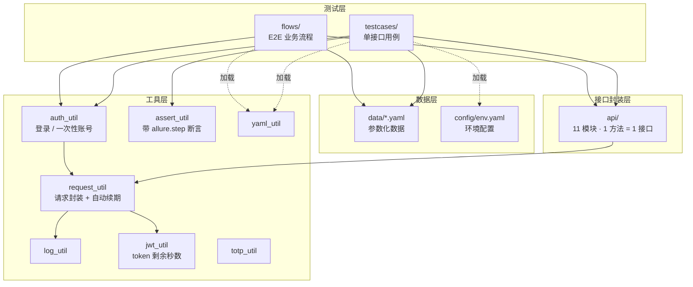
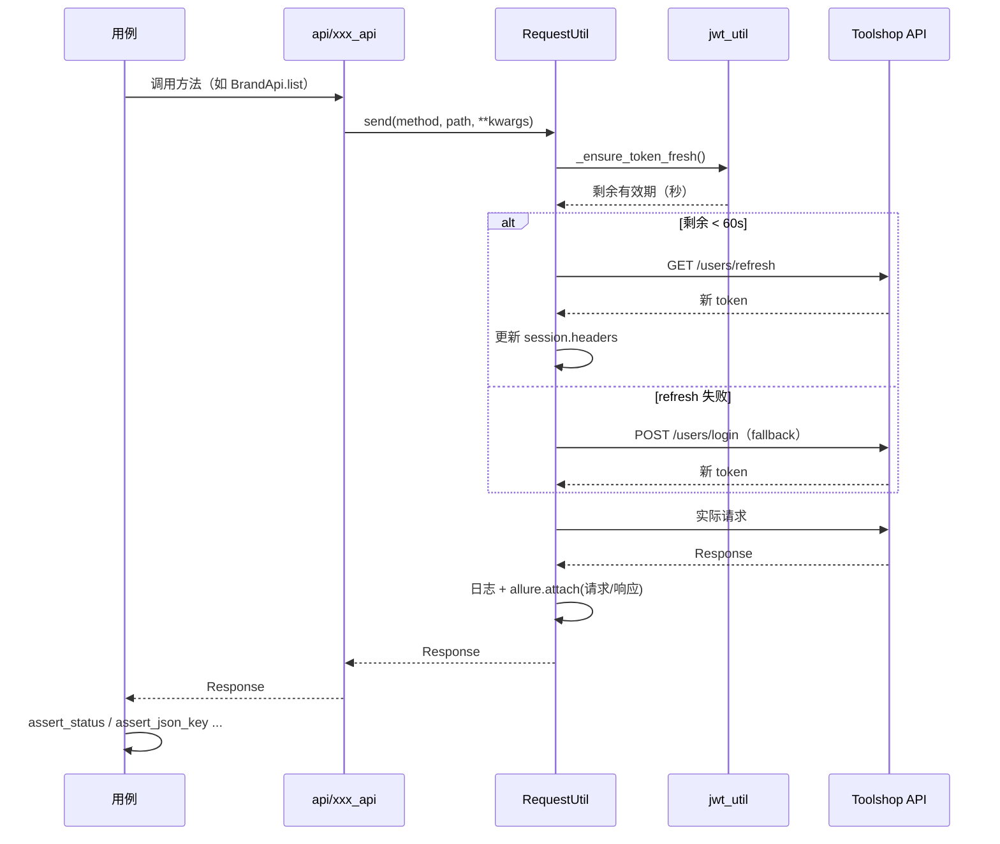
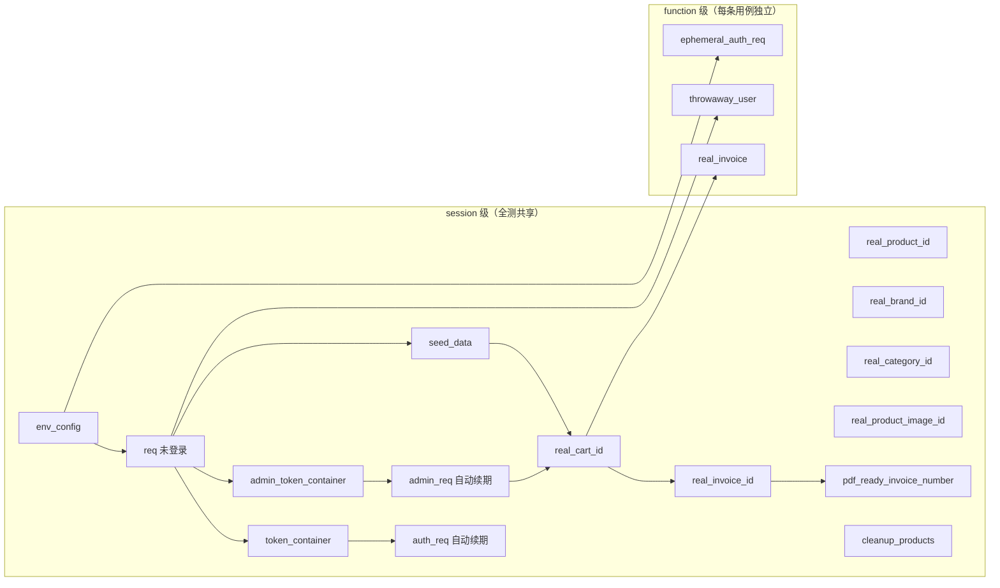
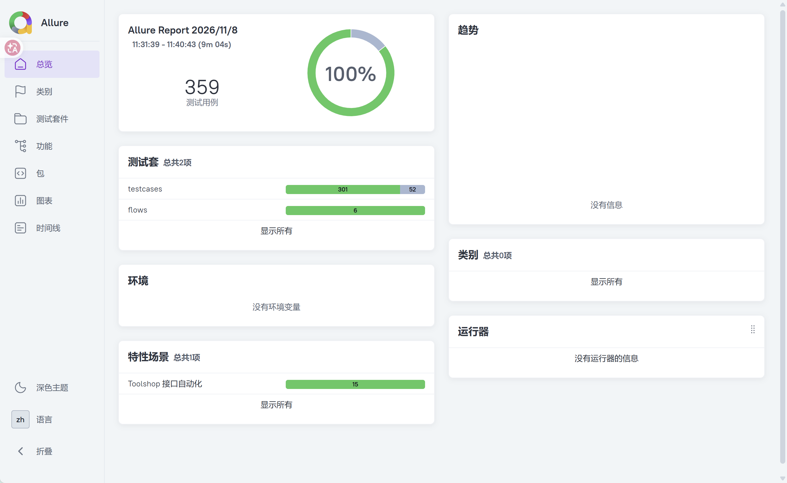
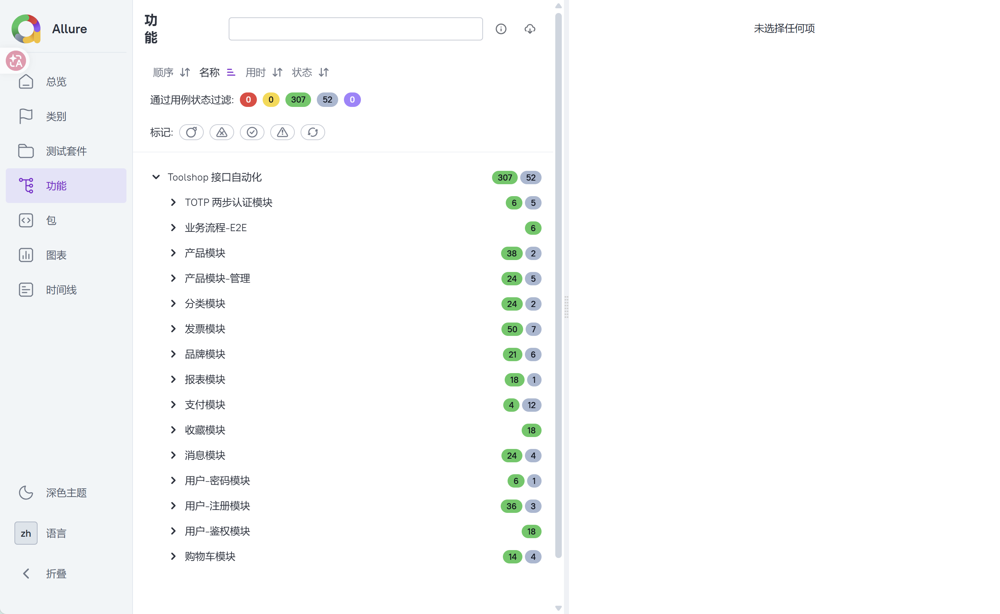
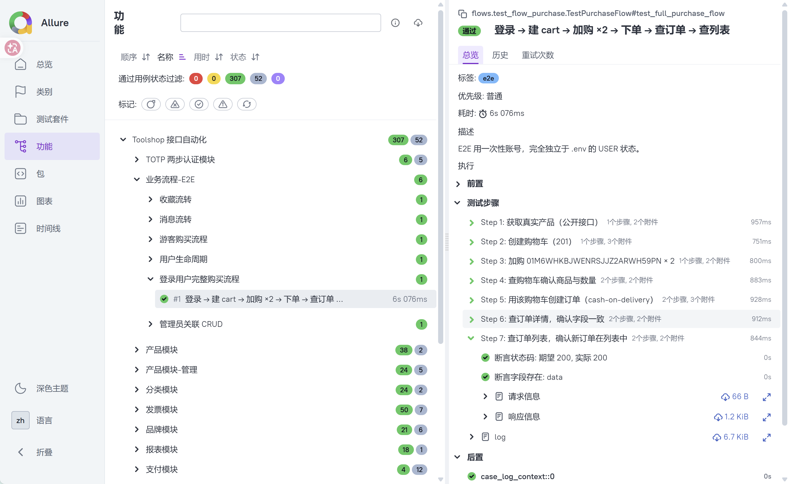

# Toolshop API 自动化测试框架

> 基于 `pytest + requests + Allure` 的 REST API 自动化测试框架，覆盖 [Practice Software Testing (Toolshop)](https://practicesoftwaretesting.com) 平台的 **11 个业务模块**、**约 350 条接口用例** 和 **6 条端到端业务流程**。
>
> 面向真实接口契约做验证，主动记录 **50+ 条服务端缺陷与契约缺口**，并用 `pytest.mark.xfail(strict=True)` 严格管理，缺陷修复后自动变红提醒。

---

## 目录

- [项目亮点](#项目亮点)
- [技术栈](#技术栈)
- [项目结构](#项目结构)
- [架构设计](#架构设计)
  - [分层架构](#分层架构)
  - [请求链路](#请求链路)
  - [Fixture 依赖关系](#fixture-依赖关系)
- [快速开始](#快速开始)
- [运行测试](#运行测试)
- [测试报告](#测试报告)
- [测试策略](#测试策略)
  - [测试分层](#测试分层)
  - [数据驱动](#数据驱动)
  - [已知缺陷管理](#已知缺陷管理)
  - [用例分布](#用例分布)
- [账号隔离与 Token 治理](#账号隔离与-token-治理)
- [已知缺陷与契约缺口清单](#已知缺陷与契约缺口清单)
- [CI/CD](#cicd)
- [如何扩展新模块](#如何扩展新模块)
- [常见问题 FAQ](#常见问题-faq)
- [致谢](#致谢)

---

## 项目亮点

### 1️⃣ Token 自动续期

`utils/request_util.py` 的 `_ensure_token_fresh()` 在**每次请求前**解析 JWT 剩余有效期，**剩余 < 60s（含已过期）时主动续期**，避免批量执行用例过程中因 token 过期而中断。

- 续期优先调用 `GET /users/refresh` 获取新 token
- 若refresh 失败则自动 fallback 至重新登录 `POST /users/login`
- 续期逻辑封装在 `RequestUtil.refresh_callback` 中，业务用例无需感知
- 实现：`utils/request_util.py` 的 `_ensure_token_fresh`，与`conftest.py` 中注入的 `auth_req.refresh_callback` 配合工作

### 2️⃣ Token 隔离策略

| Fixture | 作用域 | 适用场景 | 隔离维度 |
|---|---|---|---|
| `auth_req` / `admin_req` | session | 99% 的常规用例 | 一个 token 跑全测，自动续期 |
| `ephemeral_auth_req` | function | 会消耗/使当前 token 失效的接口（logout / refresh） | 每条用例现场登录 |
| `throwaway_user` | function | 会污染账号状态的用例（改密 / 锁定 / TOTP / 删除账号） | 每条用例现场注册一次性账号 |

> 解决的核心问题：**用例之间必须相互隔离**。例如"连续 3 次密码错误触发账号锁定"这条用例，若其与"正常登录"共享同一个 session 级账号，一旦该账号被锁定，将导致后续所有依赖该账号的用例连锁失败，整个测试会话不可用。

### 3️⃣ 契约测试意识：50+ 条缺陷用 `xfail(strict=True)` 管理

- YAML 中配置 `xfail: true` + `reason` ，代码自动转为 `@pytest.mark.xfail(strict=True)`
- `strict=True` 的作用：**服务端修复缺陷后，用例会 XPASS并显示为失败**，提醒维护者及时处理——移除 xfail 或更新期望值，避免缺陷修复后用例长期失管
- 每条 `reason` 均写明三项内容：文档约定 / 实测结果 / 缺陷归属（BUG 或契约缺口）

### 4️⃣ 真实数据源 Fixture，避免硬编码 ID

`conftest.py` 中提供一组 fixture， 从**真实接口反查关联 ID**，避免在用例中硬编码（magic string）：

- `real_product_id` / `real_brand_id` / `real_category_id`：从列表接口取真实存在的 ID
- `seed_data`：一次 `/products` 请求，反查出「被产品引用的 brand_id / category_id / product_image_id」
- `brand_in_use_id`：从产品列表中筛选出正在被引用、不可删除的 brand
- `pdf_ready_invoice_number`：从已有发票中遍历，找出 PDF 状态为 `COMPLETED` 的，供下载用例使用
- `real_cart_id` / `real_invoice_id`：session 级真实购物车 / 发票，供依赖链复用

### 5️⃣ 全链路 Allure 可观测

- 所有断言封装在 `allure.step` 中（`utils/assert_util.py`）
- 每次请求自动 `allure.attach` 请求信息（method / url / payload）
- 每次响应自动 `allure.attach` 响应信息（状态码 / body 前 500 字）
- 用例级日志：`case_log_context` fixture 自动打 start / end 分隔
- 结果钩子 `pytest_runtest_makereport` 记录 PASS / FAIL / SKIP

### 6️⃣ 数据驱动、边界值与场景法三种用例风格并存

- **数据驱动**：`data/*.yaml` + `@pytest.mark.parametrize`，同构用例只写一次代码
- **边界值**：如 `price` 上下界、`status_message` 5–50 长度、`years` 的负值与非数字输入等
- **场景法**：`flows/*.py` + `@pytest.mark.e2e`，串联真实用户的完整链路（购买 / 收藏 / 消息 / 生命周期）

### 7️⃣ TOTP 两步认证现场计算（RFC 6238）

`utils/totp_util.py` 手写 HMAC-SHA1 + 动态截断，**根据 setup 返回的 secret 现场算出当前 6 位验证码**，支持 TOTP 全流程测试（setup → verify → 后续登录），无需依赖外部认证器。

### 8️⃣ 请求异常处理与响应耗时监控

- 分别捕获 `requests.exceptions.Timeout` 、`ConnectionError` 及其他异常，记录日志后重新抛出
- 响应耗时超过 1000ms 时，自动切换展示单位（ms → s）
- `assert_response_time(resp, max_ms)` 可直接用于性能回归

### 9️⃣ 用例级资源清理

`cleanup_products` 是 session 级 teardown，记录测试期间创建的产品 ID，session 结束时统一删除，避免遗留测试数据。各模块 E2E 用例同时也用 `try/finally` 做兜底清理。

### 🔟 GitHub Actions 开箱即用

`.github/workflows/test.yaml`：支持 push / PR / 手动触发，使用 Python 3.8 执行 `pytest -m e2e` ，并上传 allure-results（保留 7 天）。

---

## 技术栈

| 层次 | 选型 | 版本 |
|---|---|---|
| 语言 | Python | 3.8+ |
| 测试框架 | pytest | 8.3.5 |
| HTTP | requests | 2.32.3 |
| 报告 | allure-pytest | 2.13.5 |
| 配置 | PyYAML | 6.0.2 |
| 环境变量 | python-dotenv | 1.0.1 |
| CI | GitHub Actions | - |

---

## 项目结构

```
项目根目录
├── conftest.py                   # 全局 fixture（env/req/auth/清理/数据源）
├── pytest.ini                    # 测试路径 + Allure 参数 + marker
├── main.py                       # IDE 运行入口（pytest.main）
├── requirements.txt
├── README.md
├── .env                          # 测试账号（gitignore）
├── .gitignore
├── .github/workflows/
│   └── test.yaml                 # GitHub Actions CI
├── api/                          # 接口封装层（11 个模块，1 方法 = 1 接口）
│   ├── brand_api.py
│   ├── cart_api.py
│   ├── category_api.py
│   ├── favorite_api.py
│   ├── invoice_api.py
│   ├── message_api.py
│   ├── payment_api.py
│   ├── product_api.py
│   ├── report_api.py
│   ├── totp_api.py
│   └── user_api.py
├── config/
│   └── env.yaml                  # 多环境配置（active_env + base_url + timeout）
├── data/                         # 测试数据（YAML 驱动，一模块一份）
│   ├── brand_data.yaml
│   ├── cart_data.yaml
│   ├── category_data.yaml
│   ├── favorite_data.yaml
│   ├── invoice_data.yaml
│   ├── message_data.yaml
│   ├── payment_data.yaml
│   ├── product_data.yaml
│   ├── report_data.yaml
│   ├── totp_data.yaml
│   └── user_data.yaml
├── testcases/                    # 单接口用例（11 个文件，353 条）
│   ├── test_brand.py
│   ├── test_cart.py
│   ├── test_category.py
│   ├── test_favorite.py
│   ├── test_invoice.py
│   ├── test_message.py
│   ├── test_payment.py
│   ├── test_product.py
│   ├── test_report.py
│   ├── test_totp.py
│   └── test_user.py
├── flows/                        # 业务流程（E2E，6 条链路）
│   ├── test_flow_admin_crud.py
│   ├── test_flow_favorite.py
│   ├── test_flow_guest_purchase.py
│   ├── test_flow_message.py
│   ├── test_flow_purchase.py
│   └── test_flow_user_lifecycle.py
├── utils/                        # 工具层
│   ├── assert_util.py            # 带 allure.step 的断言库
│   ├── auth_util.py              # 登录 / token / 一次性账号
│   ├── jwt_util.py               # JWT payload 解析、token 剩余秒数
│   ├── log_util.py               # 控制台 + 文件双输出
│   ├── request_util.py           # 统一请求封装 + 自动续期 + Allure attach
│   ├── totp_util.py              # RFC 6238 TOTP 计算
│   └── yaml_util.py              # YAML 读写
├── docs/
│   ├── API文档.md                # OpenAPI 3.2.0 接口契约
│   ├── practice-soft-testing.md  
│   └── screenshots/              # Allure 报告截图
│       ├── allure-overview.png
│       ├── allure-behaviors.png
│       └── allure-detail.png
├── logs/
│   └── test.log                  # 日志文件
└── allure-results/               # Allure 原始结果
```

> **为什么 `conftest.py` 放在根目录？** pytest 会从 `rootdir` 向上向下查找 `conftest.py`，放在根目录可同时被 `testcases/` 和 `flows/` 两个测试目录共享，避免在 `flows/` 下重复定义 fixture。

---

## 架构设计

### 分层架构



> 📸 **如需 PNG 版本**：把上面 Mermaid 代码贴到 [mermaid.live](https://mermaid.live)，右上角 Export → PNG，存到 `docs/screenshots/architecture.png`，再把 README 里的 ```mermaid 块换成 ``。

### 请求链路



### Fixture 依赖关系



---

## 快速开始

### 1. 环境要求

- Python ≥ 3.8
- 能访问 `https://api.practicesoftwaretesting.com`
- 安装 [Allure 命令行](https://allurereport.org/docs/v3/install/)（可选，仅用于本地预览报告）

### 2. 克隆与安装

```bash
git clone <你的仓库地址>
cd <项目根目录>

python -m venv .venv
source .venv/bin/activate          # Windows: .venv\Scripts\activate

pip install -r requirements.txt
```

### 3. 配置 `.env`

在项目根目录创建 `.env`（已被 `.gitignore` 忽略）：

```ini
# 管理员账号
ADMIN_EMAIL=admin@practicesoftwaretesting.com
ADMIN_PWD=welcome01

# 普通用户
CUSTOMER_EMAIL=customer@practicesoftwaretesting.com
CUSTOMER_PWD=welcome01

# 普通用户 2
CUSTOMER2_EMAIL=customer2@practicesoftwaretesting.com
CUSTOMER2_PWD=welcome01

# 普通用户 3
CUSTOMER3_EMAIL=customer3@practicesoftwaretesting.com
CUSTOMER3_PWD=pass123
```

> 账号来自官方文档 [`docs/practice-soft-testing.md`](docs/practice-soft-testing.md)。

### 4. 配置环境（可选）

`config/env.yaml` 默认指向线上环境：

```yaml
active_env: "test"
env:
  test:
    base_url: "https://api.practicesoftwaretesting.com"
    timeout: 30
```

如需指向本地环境，新增：

```yaml
active_env: "local"
env:
  local:
    base_url: "http://localhost:8091"
    timeout: 10
```

---

## 运行测试

```bash
# 全量（单接口 + E2E）
pytest

# 只跑单接口用例
pytest testcases

# 只跑 E2E 业务流程
pytest flows
# 或
pytest -m e2e

# 单个模块
pytest testcases/test_product.py

# 单个用例（-k 模糊匹配）
pytest testcases/test_user.py -k "locked"
```

`pytest.ini` 已配置默认参数：

```ini
[pytest]
testpaths = testcases flows
addopts = -vs --alluredir=allure-results --clean-alluredir
markers =
    e2e: E2E 端到端业务流测试
```

> 每次运行会**清空** `allure-results/`（`--clean-alluredir`），保证报告干净。

---

## 测试报告

### 生成 Allure 报告

```bash
pytest                                  # 1. 跑测试生成 allure-results/
allure generate allure-results -o allure-report --clean
allure open allure-report               # 或 allure serve allure-results
```

浏览器打开后即可看到：

- **Overview**：通过率 / 严重级别 / 耗时趋势
- **Behaviors**：按 `epic → feature → story` 组织的用例树（本项目已用 `@allure.epic("Toolshop 接口自动化")` 打标）
- **用例详情**：每步断言、请求体、响应体都在 `step` / `attachment` 中可展开

### 📸 截图





---

## 测试策略

### 测试分层

| 层级 | 目录 | 目的 | 用例数 |
|---|---|---|---|
| **接口级** | `testcases/` | 逐个接口验证 CRUD / 校验 / 权限 / 边界 | ~340 |
| **流程级** | `flows/` | 跨接口串联，验证真实用户路径 | 6 |
| **场景测试** | 嵌在 testcases 中 | 如"admin 依次查 4 个报表" / "setup → verify 启用 TOTP" | - |

### 数据驱动

**YAML 写法约定**（以 `data/brand_data.yaml` 为例）：

```yaml
create:
  - case_name: "创建品牌-正常"
    expect_status: 201
    expect_has_id: true
    expect_success_landed: true          # 创建后 GET 回验字段落库

  - case_name: "创建品牌-缺 name"
    omit: ["name"]                       # 从默认 payload 删除字段
    expect_status: 422

  - case_name: "创建品牌-slug 含大写"
    override: { slug: "Auto-Brand-ABC" } # 覆盖默认 payload 字段
    expect_status: 422
    xfail: true
    reason: "URL slug 惯例全小写；若实测接受则改 201 并记为契约缺口"
```

**常用约定字段**：

| 字段 | 含义 |
|---|---|
| `case_name` | 用例标题（Allure title） |
| `expect_status` | 期望状态码 |
| `override` | 覆盖默认 payload |
| `omit` / `omit_fields` / `omit_body` | 删除字段 / 整个 body |
| `login_as` | `admin` / `user` / `none`，选择请求 client |
| `xfail` + `reason` | 标记已知缺陷，strict 模式 |
| `expect_*` | 各种断言开关（`expect_has_id` / `expect_sorted_by` 等） |
| `doc_note` / `contract_note` | 契约说明，不参与断言 |

### 已知缺陷管理

`xfail(strict=True)` 的**双刃剑**作用：

- 服务端**仍有缺陷** → 用例失败 → 标记 XFAIL → 不阻塞 CI
- 服务端**修复缺陷** → 用例通过 → 标记 XPASS → **strict 模式下变成 FAIL** → 提示维护者及时更新用例

### 用例分布

> 可通过 `pytest --collect-only -q` 获取精确用例数。以下为静态统计结果：

| 模块 | 用例数 | 覆盖能力 |
|---|---|---|
| 品牌 Brand | 27 | 列表 / 详情 / 创建 / 更新 / 删除 / 权限 / 被引用冲突 |
| 购物车 Cart | 18 | 创建 / 加购 / 查询 / 改量 / 删商品 / 删车 / 全生命周期 |
| 分类 Category | 26 | 列表 / 树 / 详情 / 创建 / 删除 / 权限 / 父子关系 |
| 收藏 Favorite | 18 | 添加 / 重复 / 查询 / 列表 / 删除 / 注入 / 权限 |
| 发票 Invoice | 57 | 列表 / 搜索 / 详情 / 创建 / 游客 / PUT / PATCH / 状态 / PDF |
| 消息 Message | 28 | 发送 / 列表 / 详情 / 回复 / 附件 / 权限 / 边界 |
| 支付 Payment | 16 | 5 种支付方式 + 边界 + 类型校验 |
| 产品 Product | 69 | 列表 / 排序 / 分页 / 过滤 / 详情 / 相关 / 搜索 / 创建 / 更新 / 删除 |
| 报表 Report | 19 | 4 个报表 + 权限 + 场景 |
| TOTP | 11 | setup / verify / 权限 / 场景 |
| 用户 User | 64 | 登录 / 注册 / 忘记 / 修改 / 登出 / 刷新 / me |
| **E2E 流程** | **6** | 购买 / 游客 / 收藏 / 消息 / 管理 CRUD / 用户生命周期 |
| **合计** | **359** | - |

---

## 账号隔离与 Token 治理

这是本项目最核心的工程决策之一。

### 问题

API 测试常见的两个污染源：

1. **Token 污染**：`logout` / `refresh` 会让当前 token 失效，后续用例全 401
2. **账号状态污染**：改密码 / 连续登录失败 / 开启 TOTP / 删除账号，会让共享账号不可用

### 解决方案

| 场景 | 方案 | 实现 |
|---|---|---|
| 常规读写 | session 级 `auth_req` / `admin_req` | 自动续期，全测共享 |
| 消耗型接口（logout / refresh） | function 级 `ephemeral_auth_req` | 每次现场登录拿新 token |
| 污染型接口（改密 / 锁定 / TOTP） | function 级 `throwaway_user` | 每次现场注册一次性账号 |

### 一次性账号的注册-登录封装

`utils/auth_util.py` 的 `register_and_login_throwaway()`：

```python
suffix = f"{int(time.time())}{uuid.uuid4().hex[:6]}"
email = f"throwaway_{suffix}@example.org"
# 1. POST /users/register  → 201
# 2. POST /users/login     → 200，拿 access_token
# 3. 返回 {email, password, token, req(已带头)}
```

每次使用都产生**唯一邮箱 + 独立 token**，用完后账号留在服务端不影响任何用例。

### Token 自动续期实现

```python
def _ensure_token_fresh(self):
    if not self.refresh_callback:
        return
    auth = self.session.headers.get("Authorization", "")
    if not auth.startswith("Bearer "):
        return
    remaining = token_expires_in(auth.split(" ", 1)[1])
    if 0 <= remaining < self.refresh_threshold:   # 默认 60s
        new_token = self.refresh_callback()
        if new_token:
            self.session.headers["Authorization"] = f"Bearer {new_token}"
```

`refresh_callback` 由 `conftest.py` 注入，先试 `GET /users/refresh`，失败 fallback 到 `POST /users/login`。

---

## 已知缺陷与契约缺口清单

> 由 `data/*.yaml` 中的 `xfail: true` + `reason` 汇总。全部已通过 `xfail(strict=True)` 记录，服务端修复后，对应用例将自动转为失败以提示更新。

### 服务端 BUG

| 模块 | 用例 | 期望 | 实测 |
|---|---|---|---|
| 购物车 | 加购数量 0 / 负数 / 小数 | 422 | 404 Resource not found |
| 购物车 | 更新不在购物车的商品数量 | 4xx | 200 但 cart_items 不变 |
| 分类 | 创建时 parent_id 不存在 | 422 | 500 Something went wrong |
| 发票 | 创建时缺 billing_state / billing_postal_code | 422 | 201 成功创建 |
| 发票 | 游客下单 `/invoices/guest` | 200/201 | 404（端点未实现） |
| 发票 | status_message 长度越界（4 / 51） | 422 | 404 |
| 产品 | price 负数（create / PUT / PATCH） | 422 | 201 / 200 成功 |
| 产品 | PUT 缺 name / price | 422 | 200 成功 |
| 产品 | `/products/{id}/related` 不存在 ID | 404 | 500 |
| 产品 | `/products/search` 未传 q（文档声明 required） | 422 | 200 + 空 data |
| 消息 | name 长度 119/120（≤ maxLength 120） | 200 | 500 |
| 消息 | 附件上传不存在 messageId | 404 | 200 |
| 消息 | 回复不存在 messageId | 404 | 500 |
| 支付 | 信用卡支付 | 200 | 404（端点行为不一致） |
| 支付 | payment_method 为 null / 数字 / 未定义值 | 422 | 200（不校验 method） |
| 支付 | payment_details 为 null / 字符串 / 数组 / 空对象 | 422 | 404 |
| 支付 | 完全空 body | 422 | 200 |
| TOTP | code 长度 5 / 7 / 空 / 非数字 / 特殊字符 | 400 | 404 |
| 用户 | 注册年龄 76 / 86（文档要求 18–75） | 422 | 201 成功 |
| 用户 | 改密两次新密码不一致 | 422 | 404 |
| 品牌 | PUT 缺 name / slug（POST 校验，PUT 不校验） | 422 | 200 |
| 报表 | years=非数字 | 400/422 | 500 + HTML 错误页 |

### 契约缺口（文档未明确 / 文档与实测不一致）

| 模块 | 说明 |
|---|---|
| 品牌 / 分类 | slug 含大写，文档未禁止，实测接受 → 是否应校验存在争议 |
| 品牌 / 分类 | 创建接口 OpenAPI 未声明 `security`，实测公开可创建 → 权限归属存疑 |
| 发票 | OpenAPI 声明创建返回 200，实测 201 |
| 发票 | PDF 状态接口文档 404，实测 400 + `{"status":"NOT_INITIATED"}` |
| 支付 | 现金支付响应文案：文档 `Success status`，实测 `Payment was successful` |
| 支付 | payment_method 大小写：文档枚举大小写敏感，实测接受 `BANK-TRANSFER` |
| 用户 | change-password 成功后**旧 token 仍有效**（安全性问题，E2E 用例发现并 attach 到 Allure） |
| 用户 | 注册年龄恰好 18（生日当天）行为待业务确认 |

---

## CI/CD

`.github/workflows/test.yaml`：

| 项 | 配置 |
|---|---|
| 触发 | push to `main` / PR to `main` / 手动 `workflow_dispatch` |
| 环境 | Ubuntu latest + Python 3.8 + pip cache |
| 执行 | `pytest -m e2e`（**只跑 E2E**，全量约 5 分钟，E2E 约 1 分钟） |
| Secrets | `ADMIN_EMAIL` / `ADMIN_PWD` / `CUSTOMER_EMAIL` / `CUSTOMER_PWD` |
| 产物 | `allure-results/` 保留 7 天 |

> **CI 仅运行 E2E 的原因** 全量用例涉及大量真实数据写入与删除，若在 CI 中高频执行，将对公共测试环境造成压力。E2E 覆盖核心链路，可作为主干健康度指标；全量用例建议在本地或发布前执行。

> **注意事项**：CI 的 secrets 只有 ADMIN / CUSTOMER 两个账号。若需在 CI 中执行全量用例，需要补充 `CUSTOMER2_*`（`token_container` 默认用 CUSTOMER2）和 `CUSTOMER3_*`。

---

## 如何扩展新模块

以新增 `Image` 模块（`GET /images`）为例，共分四个步骤：

### 1. 新建 `api/image_api.py`

```python
from utils.request_util import RequestUtil

class ImageApi:
    PATH = "/images"

    def __init__(self, req: RequestUtil):
        self.req = req

    def list(self):
        return self.req.send("GET", self.PATH)
```

### 2. 新建 `data/image_data.yaml`

```yaml
list:
  - case_name: "图片列表-正常"
    expect_status: 200
    expect_is_list: true

  - case_name: "图片列表-无token"
    login_as: "none"
    expect_status: 200
```

### 3. 新建 `testcases/test_image.py`

```python
import allure, pytest
from api.image_api import ImageApi
from utils.assert_util import assert_status
from utils.yaml_util import load_yaml

@allure.epic("Toolshop 接口自动化")
@allure.feature("图片模块")
class TestImage:
    @allure.story("图片列表")
    @allure.title("{case_name}")
    @pytest.mark.parametrize(
        "case",
        load_yaml("data/image_data.yaml")["list"],
        ids=lambda c: c["case_name"],
    )
    def test_list_images(self, req, case):
        resp = ImageApi(req).list()
        assert_status(resp, case["expect_status"])
```

### 4. 更新 README 的「用例分布」表

如果涉及新 fixture，加到根目录 `conftest.py`。

---

## 常见问题 FAQ

### Q1：报 401 Unauthorized，账号登录失败

请检查 `.env` 配置是否正确，常见原因如下：

- 曾执行 `test_forgot_password_changes_password_to_welcome02` 且**未使用一次性账号**（历史版本遗留），导致 `CUSTOMER_EMAIL` 密码被改成 `welcome02`
- 该账号的密码已被 `forgot-password` 接口重置，可改用别的用户账号或改用新注册账号
- 测试执行时间较长，或中途调用过 `logout` / `refresh`，导致当前 token 失效。详见[Token 自动续期实现章节](#账号隔离与-token-治理)

### Q2：报 423 Account Locked

账号因连续 3 次密码错误被锁定。login_and_get_token() 已针对该场景给出明确报错与修复建议：注册新账号并更新 .env。

### Q3：Allure 命令找不到

需要单独安装 Allure 命令行（不是 pip 包）：

- macOS：`brew install allure`
- Windows：`scoop install allure`
- 或用 Docker：`docker run -p 5050:5050 -v $(pwd)/allure-results:/app/allure-results ...`

### Q4：为什么大量用例带 `xfail`？

这些用例对应**真实存在的服务端缺陷**，并非测试编写错误。每条均附有 `reason` ，注明期望结果与实测结果；服务端修复后 `strict=True` 会使对应用例转为失败以作提示。详见[已知缺陷与契约缺口清单](#已知缺陷与契约缺口清单)。

### Q5：为什么 E2E 用例全部用 `throwaway_user`？

E2E 涉及改密 / 登出 / 加购 / 下单等**状态污染**操作，如果用 `.env` 里的共享账号，跑一遍后账号可能被锁定或密码被改。`throwaway_user` 每次现场注册、用完即弃，保证可重复执行。

---

## 致谢

- 被测系统：[Practice Software Testing Toolshop](https://practicesoftwaretesting.com)
- 接口契约：[docs/API文档.md](docs/API文档.md)（OpenAPI 3.2.0）、[Swagger文档](https://api.practicesoftwaretesting.com/api/documentation#/)
- 需求来源：[docs/practice-soft-testing.md](docs/practice-soft-testing.md)

---

> 本项目为**个人实践及面试展示**项目，无 LICENSE。欢迎交流指正。